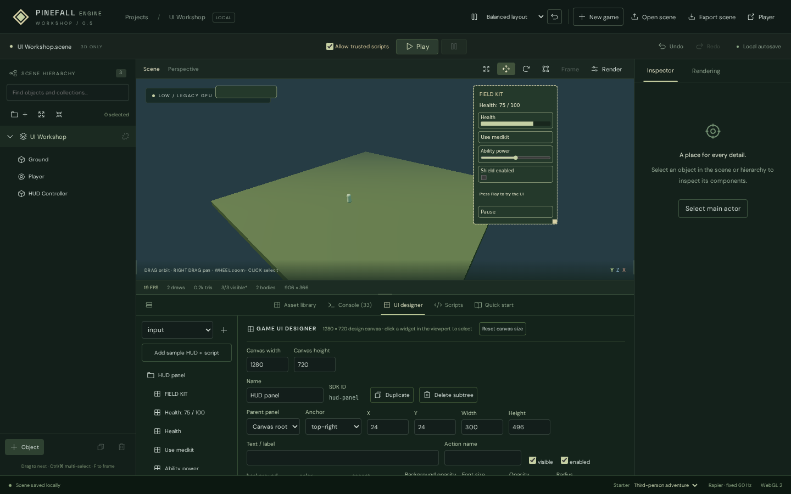

# Game UI toolkit · 0.5.0

Build interactive HUDs and menus for 3D games. UI data is part of scene JSON, not part of React/editor state. The same validated state model runs in the editor, standalone player, and headless simulator.



## Quick start

1. Create/open a scene and select **UI designer** in the bottom shelf.
2. Choose **Add sample HUD + script** for a working health bar, medkit button, ability slider, shield toggle, timer and Pause/Resume button. This replaces the current UI after confirmation; Undo restores it.
3. Select widgets in the viewport or UI list. Drag to move; drag the selected widget's bottom-right square to resize. Positions/sizes snap to 8 design pixels; hold Shift for unsnapped edits. Each completed gesture is one undo step. Exact numeric editing is also available.
4. Adjust text, colors, background opacity, font size, alignment, borders, corner radius, padding, visibility and interaction state. The custom color picker remains viewport-bounded.
5. Open **Scripts**, review the generated controller, then enable **Allow trusted scripts** and Play. Click the medkit, move the slider, and toggle the shield. The timer updates in the game loop. Pause/Resume works even while simulation is paused.
6. Stop restores authored values. Export scene JSON to preserve the UI and scripts; standalone web exports render them automatically.

The sample button inserts a separate non-rendered HUD Controller entity. Its trigger method only receives collisions if you attach that script to a physics entity. The included **`examples/projects/ui-lab.scene.json`** already attaches it to the Player: walk forward into the orange hazard to lose health; enable the shield to prevent subsequent hits. No separate scripting language or UI framework is required.

## Widgets

| Kind       | Data / event                                              |
| ---------- | --------------------------------------------------------- |
| `panel`    | Parent container; absolute, row or column child layout    |
| `text`     | Plain text, including newlines via SDK                    |
| `button`   | `click`; keyboard Enter/Space use native button behavior  |
| `progress` | Numeric value/min/max; read-only, ARIA progress semantics |
| `toggle`   | Boolean value; `change`                                   |
| `slider`   | Numeric value/min/max/step; continuous `change`           |
| `input`    | String value; `change` while typing and `submit` on Enter |
| `select`   | String value and options array; `change`                  |

A custom card, menu or status indicator is a composition of these primitives inside panels. This is not an arbitrary HTML/custom-renderer plug-in API. Values and labels are plain data; they cannot insert HTML or scripts.

## Layout

- Default reference canvas: **1280×720**. It is uniformly scaled to fit the visible 3D canvas, centered with unused space when aspect ratios differ. Anchors are relative to that fitted design canvas, not the entire application window.
- Root and nested elements support top-left, top-right, bottom-left, bottom-right and center anchors. Right/bottom X/Y are inset distances. Center X/Y are offsets from the center.
- Parents must be panels. Child anchors use the panel content area. Row/column layouts use ordered, fixed-size children with a configurable gap and scrolling; they ignore child X/Y/anchor. Drag movement is disabled for flow children; resize remains available.
- Parent visibility/enabled state affects descendants. Z order is relative to the parent stacking context. Children clip/scroll inside panels; UI clips to the viewport.
- Background opacity changes only the fill; overall opacity also affects text and descendants.
- UI uses CSS display pixels independent of the 3D render-resolution cap. It does not allocate additional Three.js scenes or physics bodies.
- Duplicate copies one widget, not its descendants. Delete removes a whole UI subtree. IDs are stable and read-only in the visual inspector; scripts use IDs, not display names.

## Typed SDK

Import from `@pinefall/sdk` in scene scripts. UI listeners registered through `ctx.ui` automatically unsubscribe when their script/entity is disposed or Play stops. Use synchronous handlers, like lifecycle hooks. Script code is trusted and host-privileged, not sandboxed.

```ts
import { Script, createUIElement, type Entity } from "@pinefall/sdk";

export default class HUD extends Script {
  health = 75;
  start() {
    this.ctx.ui.on("heal-button", "click", () => {
      this.health = Math.min(100, this.health + 10);
      this.render();
    });
    this.ctx.ui.onAction("pause", () => {
      this.ctx.engine.paused = !this.ctx.engine.paused;
      this.ctx.ui.setText("pause-button", this.ctx.engine.paused ? "Resume" : "Pause");
    });
    const message = createUIElement("text", "notification", "Notification");
    Object.assign(message, { anchor: "bottom-left", text: "Welcome", width: 400 });
    this.ctx.ui.create(message);
  }
  update() {
    this.ctx.ui.setText("hud-title", "Time: " + this.ctx.time.elapsed.toFixed(1));
  }
  trigger(other: Entity, started: boolean) {
    if (started && other.tag === "hazard") {
      this.health = Math.max(0, this.health - 20);
      this.render();
    }
  }
  render() {
    this.ctx.ui.setValue("health-bar", this.health);
    this.ctx.ui.setText("health-text", `Health: ${this.health} / 100`);
  }
}
```

Attach trigger-handling scripts to an entity with the relevant physics collider. Updating UI inside `fixedUpdate` or `ctx.onEvent(...)` is supported too. No lifecycle updates run during pause, but UI interactions continue, allowing a Resume button.

### API reference

| API                                               | Behavior                                                          |
| ------------------------------------------------- | ----------------------------------------------------------------- |
| `get(id)`                                         | Defensive copy of element, or undefined                           |
| `find(name)`                                      | First element with matching display name; prefer unique IDs       |
| `snapshot()`                                      | Defensive copy of live UI document                                |
| `create(element)`                                 | Validate and insert a new element; returns its copy               |
| `remove(id)`                                      | Remove element, descendants and their element-specific listeners  |
| `patch(id, patch)`                                | Atomic validated patch; shallow merge of style; ID/kind immutable |
| `setText(id, text)`                               | Update label/plain text                                           |
| `setValue(id, value)`                             | Update numeric, boolean or string value                           |
| `setStyle(id, partialStyle)`                      | Update color, alpha, typography, spacing, etc.                    |
| `setVisible(id, boolean)`, `show(id)`, `hide(id)` | Visibility, including descendants                                 |
| `setEnabled(id, boolean)`                         | Control interaction, including descendants                        |
| `on(id, type, callback)`                          | Listen for `click`, `change` or `submit`; returns unsubscribe     |
| `onAction(name, callback)`                        | Listen to any widget with that action name; returns unsubscribe   |

Callbacks receive `{ id, type, value, action }`. An action is a name you assign in the inspector; it is **not executable code**. Multiple controls may share an action. Input actions can fire on both change and submit; branch on `event.type` when needed.

Programmatic setters deliberately **do not emit interaction events**: this prevents feedback loops. Invalid updates throw without partially mutating state. Numeric values must be within min/max; a select value must be one of its options. `step` controls native slider increments, not programmatic quantization. UI callback exceptions disable the offending script, log context, and do not stop sibling scripts.

`ctx.ui` is the lifecycle-scoped scripting interface. `engine.ui` is the underlying `UIStore` for host applications and headless harnesses; its raw subscriptions require caller cleanup. Avoid retaining script callbacks after disposal.

## Headless tests

```ts
import { HeadlessEngine } from "../packages/headless/src";
import { parseScene } from "../packages/runtime/src/schema";

const scene = parseScene(await Bun.file("examples/projects/ui-lab.scene.json").json());
const game = await HeadlessEngine.create(scene);
game.allowSceneScripts = true; // Only for code you trust
try {
  game.step(60);
  game.ui.dispatch("heal-button", "click");
  game.ui.dispatch("power-slider", "change", 66);
  console.log(game.ui.get("health-bar")?.value);
  console.log(game.report().ui);
} finally {
  game.dispose();
}
```

`dispatch` respects interactivity, ancestor visibility/enabled state and widget/event compatibility. It returns false for blocked events and throws for invalid submitted values. `report().ui` is live UI state; the scene snapshot retains authored UI rather than pretending to be a fully resumable UI/script-state checkpoint.

```sh
bun run game script-typecheck examples/projects/ui-lab.scene.json
bun run game simulate examples/projects/ui-lab.scene.json 60 --trust-scripts
bun run build
bun run game export-web examples/projects/ui-lab.scene.json build/ui-lab-web
bun test tests
bun run test:ui  # requires dev server on 5173
NATIVE_UI=1 xvfb-run -a bun tests/ui-browser.ts # packaged Linux build
```

## Architecture, performance and boundaries

- `packages/ui/src/schema.ts`: types, defaults, validation; optional scene UI keeps old version-1 scenes compatible.
- `store.ts`: DOM-free, transactional state and events; no-op writes don't advance its revision.
- `renderer.ts`: browser-only, keyed DOM nodes, batched dirty rendering, focus-preserving control updates and editor gestures. No React dependency. Browser hosts may instantiate it directly; call `draw`, `resized` and `dispose` as appropriate. The engine handles this automatically.
- `packages/ui/src/index.ts`: DOM-free reusable entry point. Import the renderer explicitly for browser use.
- Limits: 128 widgets, panel-only acyclic parents, finite bounded coordinates/styles, text and option length limits. Plain text only; no external fonts, image widgets, rich HTML, nine-slice images, animation/tween system or arbitrary custom widget renderer yet.
- UI controls suppress game movement keys while focused; click the viewport to return keyboard input to gameplay. Pointer-lock games may require Escape to release the pointer before using the HUD.
- Designer authoring still uses the engine's existing scene reload path on committed edits. Runtime UI updates do not reload the scene or recreate physics. Dirty rendering and node reuse reduce work, but there is no physical CEDAR performance certification or long-session memory guarantee.
- Linux desktop is tested with Xvfb/SwiftShader; Windows packages are built but not executed in this environment. Both desktop distributions remain unsigned. 0.5.0 has not been published to GitHub.

## Validation for this local build

- TypeScript and Oxlint: pass, zero warnings/errors.
- 38 unit/integration tests, 144 assertions: pass, including real Rapier-trigger UI updates, headless actions, pause/resume, callback isolation and cleanup.
- Browser UI workflow: pass for editing, drag/resize and undo, actions, focus, and Stop restoration.
- Packaged Linux UI workflow: same suite passes under Xvfb/SwiftShader.
- Exported UI Lab: explicit trust, live controls and paused UI interaction pass in a browser.
- Existing color-picker, scripting, workspace/hierarchy and runtime-browser regressions: pass.
- Linux AppImage and Windows ZIP built successfully. Windows execution and physical CEDAR hardware were not tested.
